# Gloop Golf

Jelly mini golf for the whole family. It runs in any modern browser and plays great on phones and iPads. Pull back, watch the dotted line show exactly where your jelly ball will roll, and let go. 36 holes on 4 courses, windmills, portals, conveyor belts, boost pads, up to 4 players on one screen, balls that knock each other around, and 41 trophies.

**[Play it now: gloop-golf.fly.dev](https://gloop-golf.fly.dev)**

[](LICENSE)


[](https://claude.com/product/claude-code)

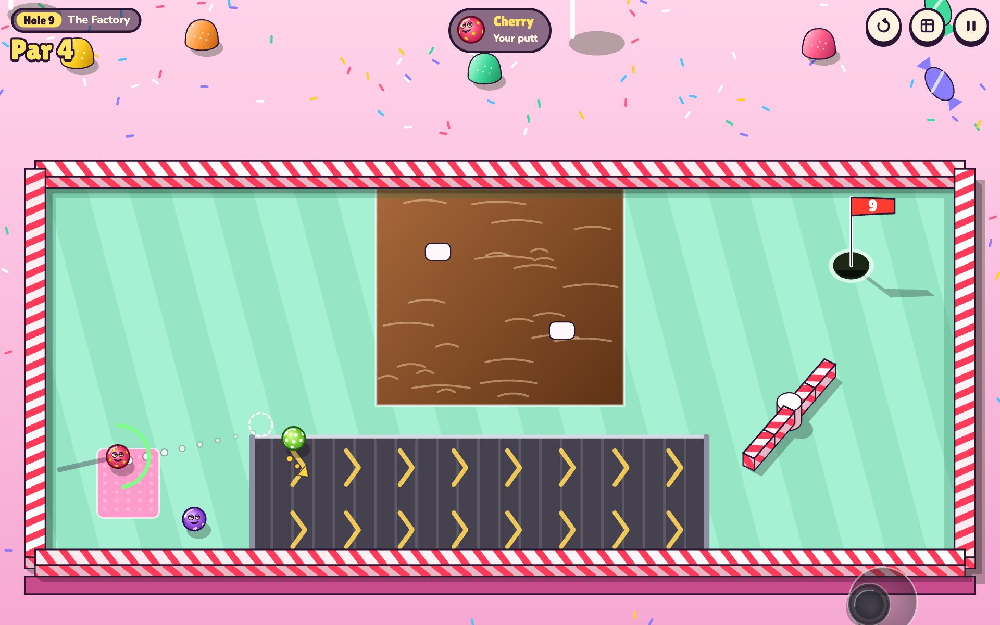

Everything you see and hear is made in code: the courses, the jelly balls and their faces, the scenery, the sound effects, and the music. The ball physics is written from scratch too. There are no image or audio files, no frameworks, no build step, and zero dependencies. Plain HTML, CSS, and JavaScript modules on a Canvas 2D renderer with Web Audio.

## Built entirely by AI

Every line of this game was written by **[Claude Code](https://claude.com/product/claude-code)**, Anthropic's agentic coding tool. It started from a one-line idea, jelly mini golf, and then a request for a 2.5D look with "a high level of polish and geometrical accuracy".

From there, Claude Code:

- wrote its own continuous collision for a round ball against rounded walls, posts, and bumpers, and proved the mirror law: across 469 test wall bounces the ball leaves at the same angle it came in, to 0.0000 degrees
- made the dotted aim line run the exact same physics as the ball, so across 348 test putts the ball never strays from the line (0.00 mm), bounces, slopes, belts, and portals included
- fired 864 full-power putts at every hole to prove the ball never sinks into a wall (0.000 mm)
- found with a test that "Too fast!" sometimes showed on putts that then dropped (4,183 of 20,910 test putts), and fixed the cup so it decides once
- wrote a solver that finishes all 36 holes at par or better, to prove every par is fair
- measured the aim with real drags and reshaped it from playtest feedback: power that follows the pull, finer aim the farther you pull, and a shorter pull for full power that keeps small putts precise
- added real ball-on-ball hits, with tests that balls never overlap and that every tee layout for 2 to 4 balls on all 36 holes is clear
- tested the game in Chromium and in WebKit (the Safari engine) at phone size
- deployed the game to Fly.io and set up this repository, the README, and the screenshots

The human part was direction and taste: the game idea, the feedback on looks and feel (the bounce angles, the power, the aim, a face that rolls with the ball), the feature list, and bug reports from real play.

## Screenshots

| Title screen | Aim with the thumbstick and the dotted line |
|---|---|
| 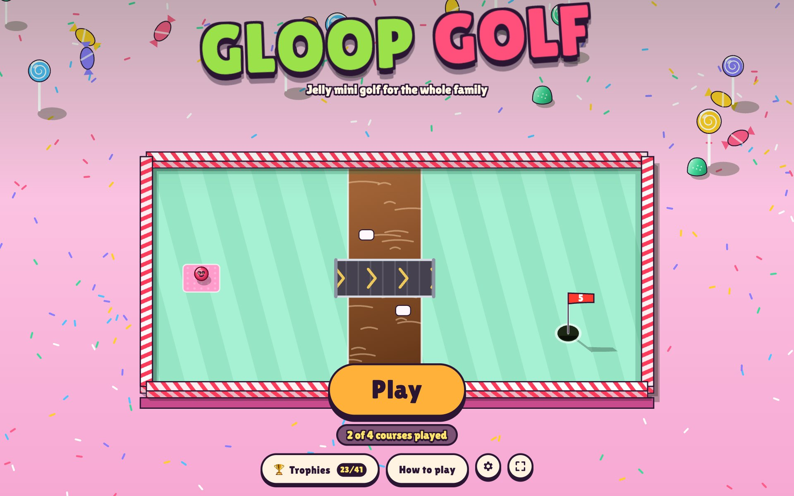 | 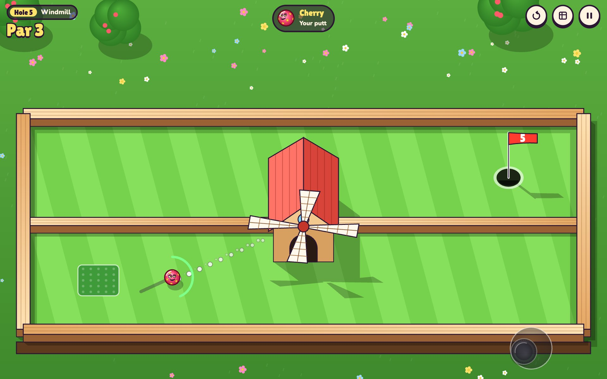 |
| **Ball hits: the line shows where the other ball goes** | **Sunny Beach** |
| 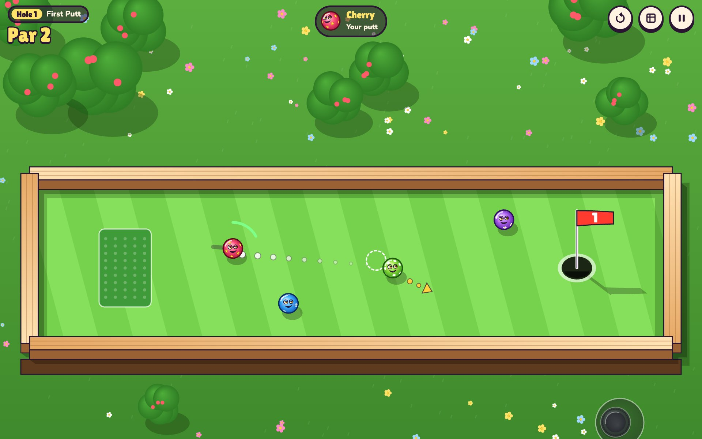 | 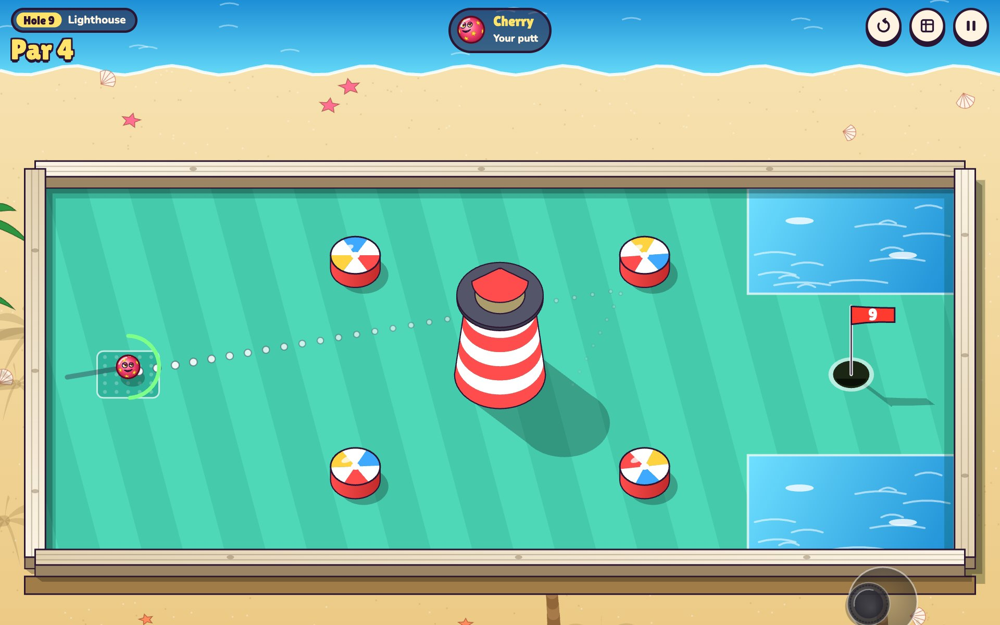 |
| **Candy Factory: portals** | **Frosty Peak: ice and boost pads** |
| 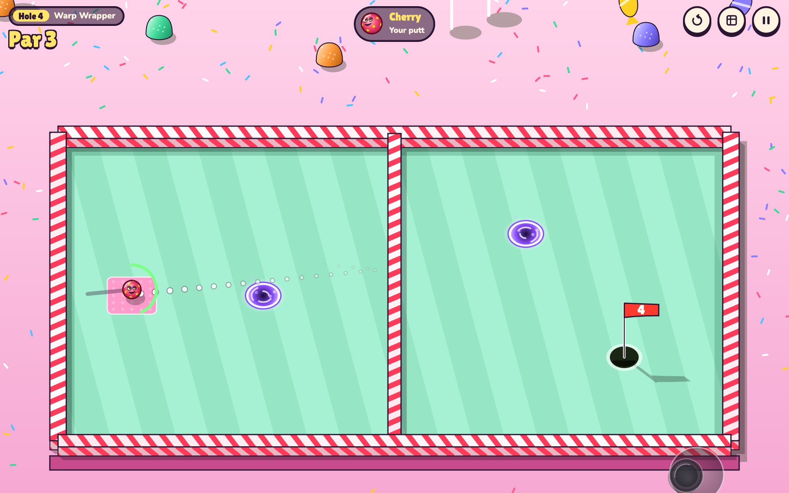 | 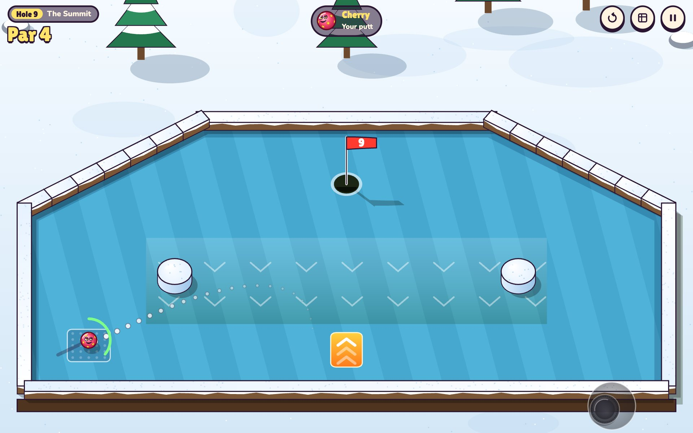 |
| **Up to 4 players: pick a color and a style** | **Pick a course** |
| 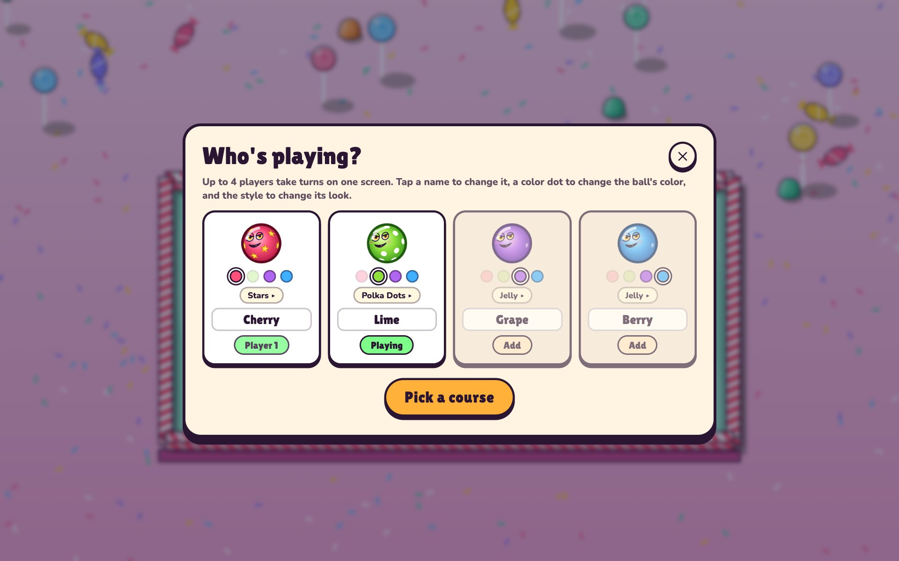 | 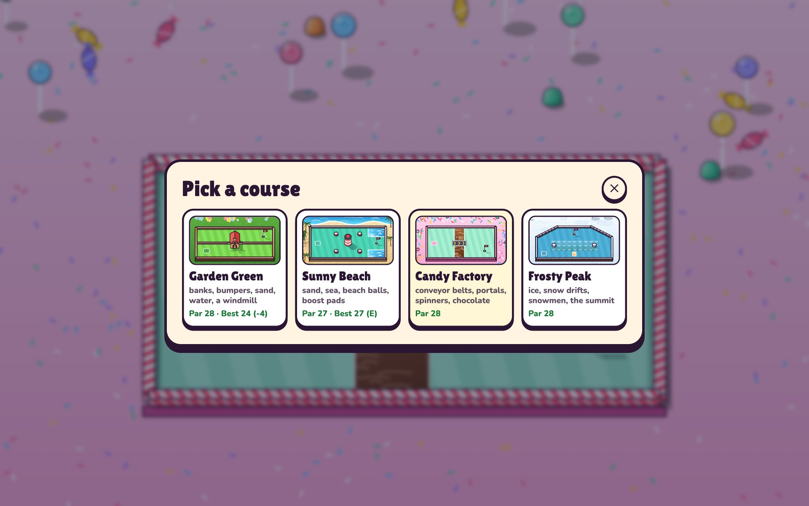 |
| **Scorecard** | **Trophies** |
| 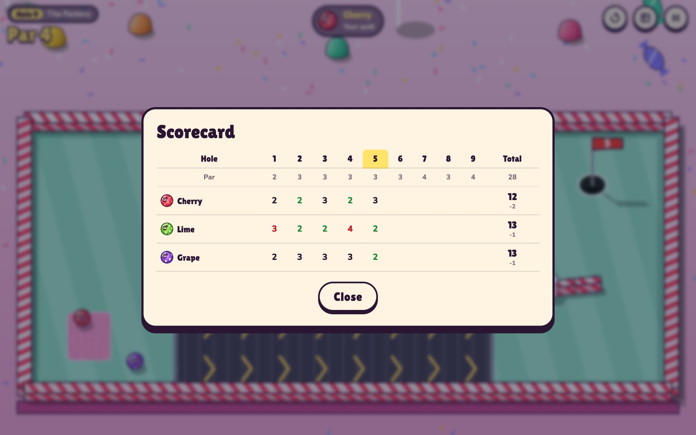 | 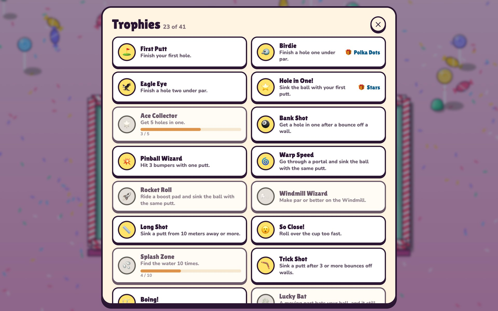 |
| **Ball styles** | **On a phone** |
| 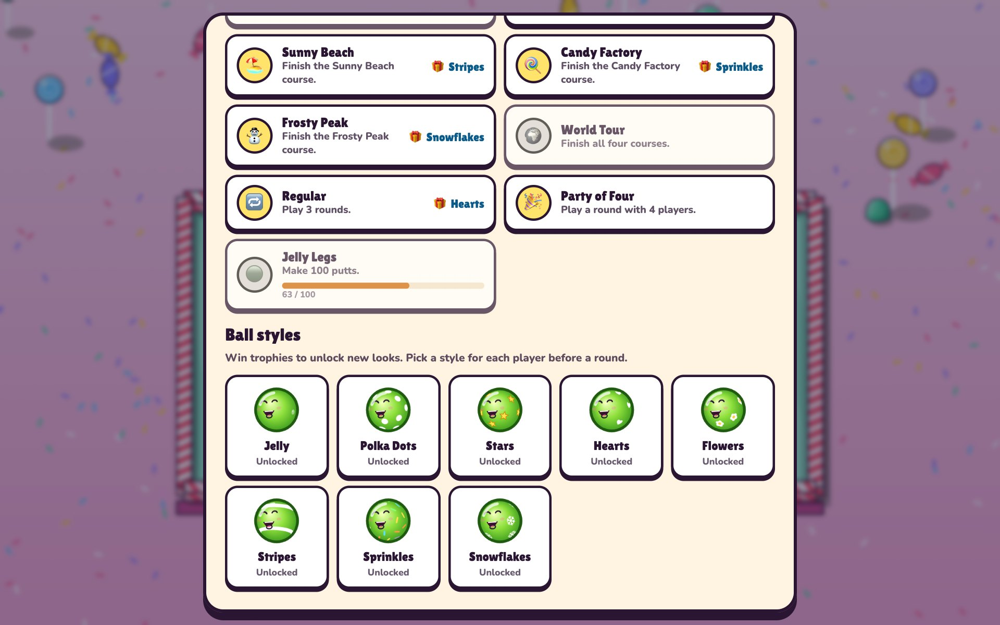 | 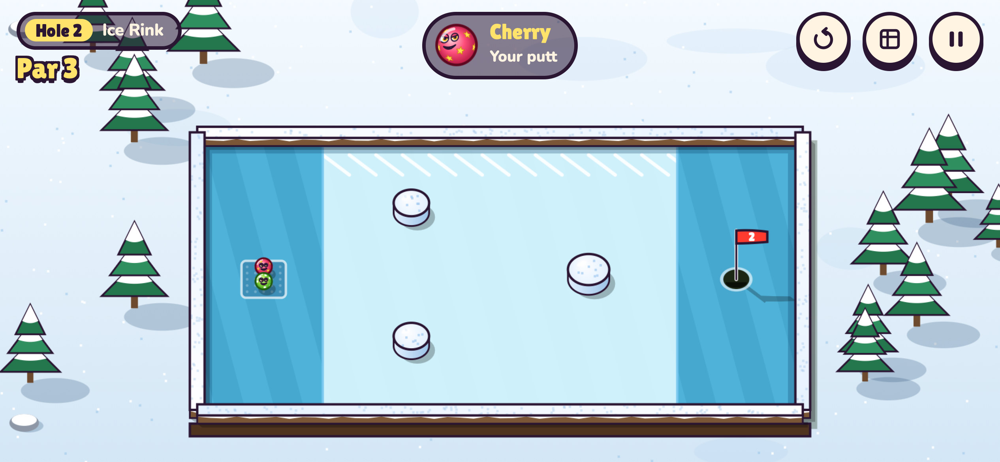 |

## Courses

Each course has 9 holes.

| Course | Par | What you find there |
|---|---|---|
| **Garden Green** | 28 | Wooden rails, jelly bumpers, sand traps, ponds, hills, ice, and a windmill |
| **Sunny Beach** | 27 | Sea, sand, beach-ball bumpers, boost pads, a sandcastle, and a lighthouse |
| **Candy Factory** | 28 | Candy-cane rails, conveyor belts, portals, gumdrops, a chocolate river, and lollipop spinners |
| **Frosty Peak** | 28 | Ice rinks, snow drifts, snowmen, a frozen pond, a snowplow, and The Summit |

## Obstacles and surfaces

| Thing | What it does |
|---|---|
| **Rails and blocks** | The ball bounces off at the same angle it came in |
| **Jelly bumpers** | Kick the ball away a little faster |
| **Windmill, sliding walls, spinners** | Moving parts that block the way or bat the ball |
| **Sand** | Slows the ball down fast |
| **Ice** | The ball slides a long way |
| **Hills** | Pull the ball to one side |
| **Water** | Back to where you putted from, plus 1 stroke |
| **Boost pads** | Shoot the ball the way the arrows point |
| **Conveyor belts** | Carry the ball along. One is a bridge over the chocolate river. |
| **Portals** | The ball comes out of the twin portal, going the same way |

The dotted line shows every one of these, except the moving parts.

## Playing together

Up to 4 players share one screen. By default they take turns: each player putts once, then the next player goes.

- Every ball stays on the field where it stopped. Each player starts on their own spot on the tee.
- Balls hit each other. The dotted line stops where your ball would touch another ball, and gold dots show where that ball would go.
- A ball knocked into the cup counts for its player, with no extra stroke. A ball knocked into the water goes back to its spot, with no penalty.
- When your ball drops, you are done with that hole.

Turn off "Take turns" in Settings to play the classic way: each player putts until the ball drops.

## Trophies and ball styles

**41 trophies**, for example:

- **Shots**: Hole in One, Bank Shot, Eagle Eye, Long Shot, Trick Shot (3 wall bounces, then in), Feather Touch, Full Send
- **Ball physics**: Second Chance (too fast over the cup, then it drops anyway), Lucky Bat (a moving part bats your ball in), Ice Skater, Curve Ball, Belt Rider, Marathon Roll, Seeing Stars
- **Balls that hit each other**: Carom! (bounce off another player's ball and sink), Helping Hand, Double Drop, Strike!, Chain Reaction, Dunk Tank
- **Courses**: one for each course, World Tour, Clean Card, Under Par

Seven trophies unlock **ball styles**: Polka Dots, Stars, Hearts, Flowers, Stripes, Sprinkles, and Snowflakes. Pick a color and a style for each player before the round. Trophies, best scores, and settings are saved in the browser (`localStorage`).

## Controls

- **Touch or mouse**: touch anywhere and drag back, away from where you want the ball to go. Let go to putt. Slide back to where you started to cancel.
- **Power**: a short pull is a soft putt. Near the end of the pull, the power grows faster.
- **Fine aim**: on a long pull, moving your finger sideways turns the aim only a little, so you can set far shots and bank shots exactly. A see-through thumbstick shows the pull and the true aim while you drag.
- **Restart a hole**: the round-arrow button on the HUD.
- **Keyboard**: `Esc` or `P` pauses, `R` restarts the hole.

## iPad and phones

- Touch aiming, with page zoom and scroll gestures blocked during play.
- Add to Home Screen for full-screen play with an app icon.
- A service worker caches the game, so it also loads offline after the first visit.
- Landscape is best. In portrait, a hint suggests turning the device.
- Sound starts with your first tap, as iPhone and iPad require.

## How the physics works

`public/js/golf.js` holds the rules and the ball physics. It has no DOM code, so the tests play whole holes in Node.

- **Exact sweeps**: each tick, the ball moves straight to its first contact. Walls and blocks are boxes grown by the ball radius with round corners, and posts, bumpers, and other balls are circles grown by the ball radius, so the time of contact is exact. Then the ball bounces and moves on with the time that is left.
- **Mirror bounces**: only the speed into a surface is lost, so a glancing hit keeps almost all its speed. Below 0.3 m/s into a surface, the ball slides along it.
- **Moving parts** bounce the ball relative to their own speed, and spinners add the speed of the arm at the point of contact.
- **Ball on ball**: equal balls swap the closing speed along the line between their centers (less 15%), and each keeps its own speed across it.
- **Rolling**: a steady slow-down on each surface (grass, sand, ice), relative to the belt on a conveyor. Slopes push, boost pads push along their arrows, and the cup pulls a slow ball in a little.
- **The cup** decides once, when the ball first rolls over it: under 5.5 m/s it drops, faster it hops the hole.
- **One tick for both**: the real ball and the aim line call the same `tick()`, at 120 ticks per second.

The view is 2.5D: the ground is tilted toward the camera, solids are drawn back to front, and the ball's face turns with a 3D orientation that rolls with the ball and turns back to the player when it stops.

## Run locally

Requires Node.js 18 or newer. No install step.

```bash
node server.mjs
```

Then open http://localhost:5180. To share a temporary public link (needs [cloudflared](https://developers.cloudflare.com/cloudflare-one/connections/connect-networks/downloads/)):

```bash
./start.sh
```

## Tests

```bash
npm test
```

| Test | What it checks |
|---|---|
| `test/geometry.test.mjs` | Wall bounces leave at the angle they came in; full-power putts never pass into a solid; rails stay outside the fairway |
| `test/predict.test.mjs` | The real ball never strays from the aim line |
| `test/holes.test.mjs` | Portal links, belt bridges, and a solver that plays every hole and shows the fewest strokes it needed |
| `test/cup.test.mjs` | "Too fast!" never shows for a ball that then drops, and the aim line agrees with the ball about the cup |
| `test/balls.test.mjs` | Tee spots for 2 to 4 balls on every hole, and ball-on-ball hits: speed kept, no overlap, exact contact on the aim line |
| `test/trophies.test.mjs` | Each trophy is given for the right putt, and not for a near miss |

## Deploy

The live site runs on [Fly.io](https://fly.io) as a small nginx container with strict security headers:

```bash
fly deploy --remote-only --ha=false
```

Files: `Dockerfile`, `deploy/nginx.conf`, `fly.toml`.

## Project structure

```
public/
  index.html            page shell and DOM screens
  css/style.css         UI styles
  js/main.js            boot, gesture blocking, service worker registration
  js/golf.js            rules and ball physics: sweeps, bounces, surfaces, cup, portals, ball hits
  js/physics.js         body type and helpers used by golf.js
  js/course.js          the 4 courses and 36 holes
  js/game.js            input, aim, turns, effects, and drawing
  js/view.js            2.5D projection and the course, solids, and shadows
  js/scenery.js         beach, candy, and frost scenery, belts, boost pads, portals
  js/themes.js          colors and styles for each course
  js/ballart.js         the jelly balls, their styles, and the rolling face
  js/gloop-art.js       ball colors and faces
  js/spin.js            the ball's 3D orientation (roll and settle)
  js/trophies.js        trophies and the ball styles they unlock
  js/audio.js           sound effects and music
  js/baked.js           pre-rendered sound effects
  js/ui.js              menu, setup, course picker, HUD, scorecard, trophies, settings
  js/store.js           saved progress
  js/util.js            small math helpers
  sw.js                 offline cache (network first)
server.mjs              zero-dependency static server with no-cache headers
test/                   physics, aim line, hole, cup, ball, and trophy tests
tools/make-icons.cjs    renders the app icons from the game art (needs Playwright)
docs/screenshots/       README images
```

## Debugging

`window.__gg` is the game object in the browser console. For example, `__gg.startCourse([{ name: 'Cherry', color: 'cherry', style: 'jelly' }], 'frost')` starts Frosty Peak.

## License

[MIT](LICENSE)
